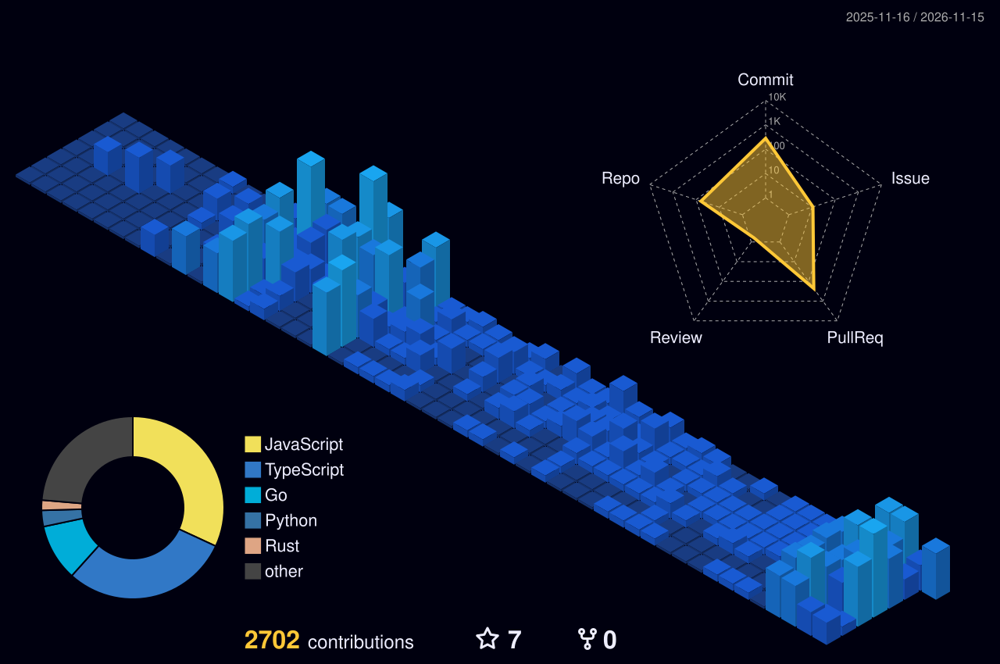

<!-- ==================== ANIMATED WAVING HEADER ==================== -->

 

<!-- ==================== QUICK BADGES ==================== -->

  

  <b>Senior Frontend / Full-Stack Engineer</b> building high-performance, polished user interfaces and architecting mission-critical logic, concurrency-safe engines, and scalable B2B SaaS applications. 
  Bridging <b>4 years of operational cash flow and accounting domain expertise</b> (B.Com in Accounting & Finance) with deep engineering across <b>React 19, TypeScript, Next.js, Node.js, and PostgreSQL</b>. 
  Active core contributor across top-tier open-source platforms (<b>Twenty CRM, Better-Auth, Snitch, Umami, Cap, Chatwoot, Infisical, Inbox Zero, Codex AutoRunner, Plane</b>), with <b>25+ merged production-grade pull requests</b> solving passive TLS C2 security & process firewalling, modern OAuth & identity revalidation, web analytics & telemetry, audio playback & video streaming synchronization, UI state management, and real-time integration workflows.

---

<!-- ==================== FAVORITE TOOLS & TECHNOLOGIES ==================== -->
## 💻 My Favorite Tools & Technologies

<table align="center">
  <tr>
    <td align="center" width="105">
      
       <b>TypeScript</b>
    </td>
    <td align="center" width="105">
      
       <b>JavaScript</b>
    </td>
    <td align="center" width="105">
      
       <b>React 19</b>
    </td>
    <td align="center" width="105">
      
       <b>Next.js</b>
    </td>
    <td align="center" width="105">
      
       <b>Tailwind CSS</b>
    </td>
    <td align="center" width="105">
      
       <b>Node.js</b>
    </td>
    <td align="center" width="105">
      
       <b>NestJS</b>
    </td>
    <td align="center" width="105">
      
       <b>PostgreSQL</b>
    </td>
  </tr>
  <tr>
    <td align="center" width="105">
      
       <b>Redis</b>
    </td>
    <td align="center" width="105">
      
       <b>Prisma</b>
    </td>
    <td align="center" width="105">
      
       <b>GraphQL</b>
    </td>
    <td align="center" width="105">
      
       <b>Docker</b>
    </td>
    <td align="center" width="105">
      
       <b>Actions</b>
    </td>
    <td align="center" width="105">
      
       <b>Git</b>
    </td>
    <td align="center" width="105">
      
       <b>Vite</b>
    </td>
    <td align="center" width="105">
      
       <b>VS Code</b>
    </td>
  </tr>
  <tr>
    <td align="center" width="105">
      
       <b>Python</b>
    </td>
    <td align="center" width="105">
      
       <b>MongoDB</b>
    </td>
    <td align="center" width="105">
      
       <b>Vitest</b>
    </td>
    <td align="center" width="105">
      
       <b>Jest</b>
    </td>
    <td align="center" width="105">
      
       <b>HTML5</b>
    </td>
    <td align="center" width="105">
      
       <b>CSS3</b>
    </td>
    <td align="center" width="105">
      
       <b>REST APIs</b>
    </td>
    <td align="center" width="105">
      
       <b>GitHub</b>
    </td>
  </tr>
</table>

---

## 💼 Featured Enterprise & Client Systems

### 🏢 [TAMAYOZ — Enterprise ERP Web Platform (Crevisoft)](https://tamayoz-alpha.vercel.app)
*Modular enterprise web client integrated with the Odoo ERP ecosystem.*
- **Repository**: [github.com/ghazy2001/Tamayoz](https://github.com/ghazy2001/Tamayoz)
- **Live Platform**: [tamayoz.crevisoft.com](https://tamayoz.crevisoft.com/) | [Preview Demo](https://tamayoz-alpha.vercel.app)
- **Tech Stack**: React 19, TypeScript, Vite, Tailwind CSS, Zustand, Framer Motion, Recharts, REST APIs, JSON-RPC.
- **Impact**:
  - Slashed initial page load times by **45% (sub-1.2s LCP)** and achieved **100% WCAG 2.1 AA** compliance via virtualized data grids and keyboard-navigable ARIA primitives.
  - Boosted data visualization render speeds by **50% for 10,000+ records** with a dynamic multi-view rendering engine (Kanban, Gantt, editable tables).
  - Reduced component re-renders by **65%** across nested views with scalable Zustand state slices.

### 🛍️ [STORIA — Full-Stack E-Commerce Engine](https://storia-salla.vercel.app)
*Custom commercial e-commerce solution with automated Salla merchant platform integration.*
- **Repository**: [github.com/ghazy2001/storia-salla](https://github.com/ghazy2001/storia-salla)
- **Live Platform**: [storiasa.com](https://storiasa.com/) | [Preview Demo](https://storia-salla.vercel.app)
- **Tech Stack**: React, Node.js, Express.js, MongoDB, REST APIs, Salla Webhooks.
- **Impact**:
  - Increased online checkout completion by **25%** and reduced sync latency by **70%** via automated real-time webhooks.
  - Saved 15+ hours/week of manual operations through automated catalog and inventory synchronization.
  - Achieved sub-200ms API response times and 99.9% uptime with structured MongoDB indexing.

---

## 🌐 Featured Merged Open-Source Contributions

High-impact production-grade pull requests reviewed, approved, and merged upstream across venture-backed and widely adopted open-source ecosystems:

### 💼 **[Twenty CRM](https://github.com/twentyhq/twenty)** *(Enterprise Open-Source CRM, 25k+ ⭐)*
- **AI Chat Reasoning Signature Drift Prevention**: Omitted historical reasoning parts across browsing contexts to prevent Gemini thinking signature drift and context corruption in multi-turn AI interactions ([PR #30183](https://github.com/twentyhq/twenty/pull/30183) — **MERGED**).
- **Timeline Activity Field Diff Tooltip & Truncation**: Prevented timeline diff value hard-truncation on long field changes and enabled full-text tooltip previews across activity feeds ([PR #29198](https://github.com/twentyhq/twenty/pull/29198) — **MERGED** by founder Charles Bochet).
- **Sign-in Infinite Loader Fix**: Prevented indefinite spinner freeze during sign-in when public workspace metadata is present by deriving active query loading state ([PR #29316](https://github.com/twentyhq/twenty/pull/29316) — **MERGED**).
- **Slack Message Unfurl Inputs**: Exposed `unfurlLinks` and `unfurlMedia` in `slack-post-message` input schema ([PR #29168](https://github.com/twentyhq/twenty/pull/29168) — **MERGED**).
- **IMAP / SMTP Credential Sanitization**: Trimmed and sanitized whitespace in mail server and username fields ([PR #29163](https://github.com/twentyhq/twenty/pull/29163) — **MERGED**).
- **Workflow Step Output Preservation**: Preserved code step outputs on save and cleaned legacy link output schema ([PR #28432](https://github.com/twentyhq/twenty/pull/28432) — **MERGED**).
- **Form Submission Validation Block**: Blocked record form submissions on active field validation errors ([PR #28425](https://github.com/twentyhq/twenty/pull/28425) — **MERGED**).
- **Metadata Store Hash Synchronization**: Adopted new collection hash on replaceDraft when data remains unchanged ([PR #28412](https://github.com/twentyhq/twenty/pull/28412) — **MERGED**).

### 🛡️ **[Snitch](https://github.com/aixisstudio/Snitch)** *(Process Firewall & Security Inspection Agent)*
- **Native Passive TLS ClientHello Fingerprinting (JA3 / JA4) & C2 Detection**: Engineered zero-dependency wire-level ClientHello parser, RFC 8701 GREASE filtering, canonical JA3 MD5 & JA4 hashing, offline C2 fingerprint database (Cobalt Strike, Sliver, Havoc, Metasploit, Mythic, AsyncRAT), real-time `C2_SUSPECT` alerting, and custom rules engine integration ([PR #86](https://github.com/aixisstudio/Snitch/pull/86) — **MERGED** with maintainer commendation: *"Merged — and this revision is exactly what a security DB should look like: verifiable JA3s only, every entry carrying source + provenance... Snitch now ships real, passive C2 detection. 🤝"*).
- **ThreatFox C2 Threat-Feed Ingestion (Parser & Presets)**: Engineered native parser for abuse.ch ThreatFox C2 indicators (CC0), public IP & domain sanitization, malware family filtering, and scheduled threat-feed presets ([PR #85](https://github.com/aixisstudio/Snitch/pull/85) — **MERGED** with maintainer commendation: *"The parser handles both ThreatFox CSV and JSON with proper IP sanitization... Ready for Priority 2 (JA3/JA4) whenever you are"*).
- **Parent/Cmdline Firewall Blocking & Netsh Lifecycle Fix**: Added command-line and parent-process blocking rules, enriched agent event ingestion, and eliminated Windows firewall orphan rules by fixing netsh rule naming mismatches ([PR #84](https://github.com/aixisstudio/Snitch/pull/84) — **MERGED** with founder commendation: *"three real bugs caught and cleanly fixed"*).

### 📊 **[Umami](https://github.com/umami-software/umami)** *(Privacy-focused Analytics, 25k+ ⭐)*
- **Background Tab Core Web Vitals Discard**: Prevented distorted Core Web Vitals (LCP/FCP) metrics by tracking `firstHiddenTime` and discarding background tab loads per Chrome Web Vitals standards ([PR #4724](https://github.com/umami-software/umami/pull/4724) — **MERGED**).
- **Retention Cohort Timezone Shift**: Resolved timezone shift in retention cohort dates using `parseBackendDate` ([PR #4690](https://github.com/umami-software/umami/pull/4690) — **MERGED**).
- **Custom Date Range Crash Prevention**: Prevented `RangeError` crashes on unselected or invalid custom date ranges ([PR #4692](https://github.com/umami-software/umami/pull/4692) — **MERGED**).
- **LookupField Wildcard ComboBox State**: Controlled ComboBox value state in LookupField to prevent clearing custom wildcard paths ([PR #4696](https://github.com/umami-software/umami/pull/4696) — **MERGED**).
- **Visitor Count Journey Step Sorting**: Sorted user journey steps by total visitor count ([PR #4687](https://github.com/umami-software/umami/pull/4687) — **MERGED**).
- **Security Settings Reorganization**: Reorganized password management into dedicated security settings ([PR #4654](https://github.com/umami-software/umami/pull/4654) — **MERGED**).

### 🔑 **[Better-Auth](https://github.com/better-auth/better-auth)** *(Comprehensive TypeScript Authentication Framework, 16k+ ⭐)*
- **Discovery Headers Same-Origin Preservation**: Preserved `discoveryHeaders` during discovery revalidation and sent them exclusively to same-origin JWKS endpoints ([PR #12179](https://github.com/better-auth/better-auth/pull/12179) — **MERGED**).

### 🎥 **[Cap](https://github.com/CapSoftware/Cap)** *(High-Performance Screen Recorder, 7.5k ⭐)*
- **Developer API Pagination Bounds**: Hardened API query validation against fractional/oversized parameters and negative offsets ([PR #3576](https://github.com/CapSoftware/Cap/pull/3576) — **MERGED**).
- **Playback Store Late Duration Updates**: Notified subscribers when late `fallbackDuration` updates the playback store ([PR #2988](https://github.com/CapSoftware/Cap/pull/2988) — **MERGED**).
- **Toolbar Reactions Auth Guard**: Integrated sign-in prompt overlay when unauthenticated viewers react with emojis ([PR #2977](https://github.com/CapSoftware/Cap/pull/2977) — **MERGED** by founder Richie McIlroy).
- **Vinxi Timestamp Sidecar Ignoring**: Ignored Vinxi timestamp sidecars in `.gitignore` tooling ([PR #2927](https://github.com/CapSoftware/Cap/pull/2927) — **MERGED**).
- **Turbo Config Optimization**: Deduped `.env` in `turbo.json` and dropped deprecated `--no-cache` flag ([PR #2926](https://github.com/CapSoftware/Cap/pull/2926) — **MERGED**).

### 🔐 **[Infisical](https://github.com/Infisical/infisical)** *(Secret Ops & Encryption Platform, 18k ⭐)*
- **Cloudflare Workers Secret Sync Details**: Fixed display of plaintext and JSON sync variables in Cloudflare Workers sync details drawer ([PR #8885](https://github.com/Infisical/infisical/pull/8885) — **MERGED**).

### 💬 **[Chatwoot](https://github.com/chatwoot/chatwoot)** *(Customer Engagement Infrastructure, 23k ⭐)*
- **Voice Announcement Draft Toggle Persistence**: Preserved unsaved announcement draft upon toggle switch and prevented empty uncheck PATCH requests ([PR #16428](https://github.com/chatwoot/chatwoot/pull/16428) — **MERGED**).

### ✉️ **[Inbox Zero](https://github.com/elie222/inbox-zero)** *(AI Personal Email Assistant, 5.5k ⭐)*
- **Inline Email Preview Engine**: Demanded active mail engine before expanding inline email previews in chat assistant ([PR #4395](https://github.com/elie222/inbox-zero/pull/4395) — **MERGED** by founder `@elie222`).

### 🤖 **[Codex AutoRunner](https://github.com/Git-on-my-level/codex-autorunner)** *(Multi-Agent Autonomous Execution Engine)*
- **Hosted Mode Launch Capability Previews**: Issued and injected scoped launch capability URLs (`/preview/p/<token>/`) for managed dev servers to eliminate 401s on unauthenticated public previews and HMR assets ([PR #2116](https://github.com/Git-on-my-level/codex-autorunner/pull/2116) — **MERGED**).

### 📋 **[Plane](https://github.com/makeplane/plane)** *(Open-Source Project Tracking, 35k ⭐)*
- **Profile Settings Validation**: Allowed saving profile settings with an empty last name ([PR #10147](https://github.com/makeplane/plane/pull/10147) — **MERGED**).

---

  <picture>
    <source media="(prefers-color-scheme: dark)" srcset="profile-3d-contrib/profile-night-view.svg" />
    <source media="(prefers-color-scheme: light)" srcset="profile-3d-contrib/profile-gitblock.svg" />
    
  </picture>

---

## 📊 Activity & Telemetry

<table border="0">
  <tr>
    <td valign="top">
      
    </td>
    <td valign="top">
      
    </td>
  </tr>
</table>

 

---

## 🪙 Bounties, Grants & GitHub Sponsors

| Platform / Asset | Network | Link / Address |
|:---:|:---:|---|
| **GitHub Sponsors** | **Official** | [sponsor/@ghazy2001](https://github.com/sponsors/ghazy2001) |
| **USDC** | **Solana (SOL)** | `2Vuqg98hhs7zyzp5YDn2mrhMKagnwvZ9iUDa5PhCgLhF` |
| **USDT** | **Solana (SOL)** | `2Vuqg98hhs7zyzp5YDn2mrhMKagnwvZ9iUDa5PhCgLhF` |
| **SOL** | **Solana (Native)** | `2Vuqg98hhs7zyzp5YDn2mrhMKagnwvZ9iUDa5PhCgLhF` |

---

## 📬 Contact & Connect

- 🌐 **Portfolio**: [mahmoudghazy-portfolio.vercel.app](https://mahmoudghazy-portfolio.vercel.app/)
- 📧 **Email**: [mahmoudghazy2001@gmail.com](mailto:mahmoudghazy2001@gmail.com)
- 💼 **LinkedIn**: [linkedin.com/in/mahmoud-ghazy](https://www.linkedin.com/in/mahmoud-ghazy-dev/) (or [mahmoud-ghazy-48a19924a](https://www.linkedin.com/in/mahmoud-ghazy-48a19924a/))
- 🐙 **GitHub**: [@ghazy2001](https://github.com/ghazy2001)
- 💬 **Discord**: `mahmoudghazy6884`

 

  <picture>
    <source media="(prefers-color-scheme: dark)" srcset="https://raw.githubusercontent.com/ghazy2001/ghazy2001/output/pacman-contribution-graph-dark.svg" />
    <source media="(prefers-color-scheme: light)" srcset="https://raw.githubusercontent.com/ghazy2001/ghazy2001/output/pacman-contribution-graph.svg" />
    
  </picture>

 

<!-- ==================== ANIMATED WAVING FOOTER ==================== -->

  Senior Frontend / Full-Stack Engineer • Open for Remote Contracts, Retainers, and Engineering Roles

